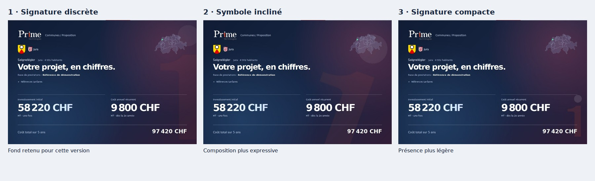
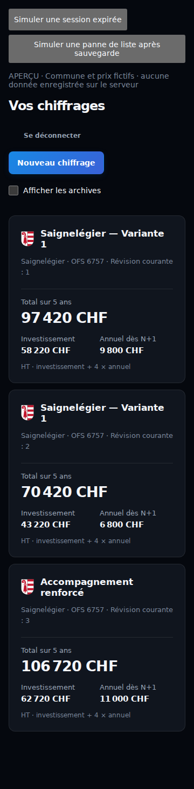

# Offre et liste des chiffrages — r5 · 23 octobre 2026

Le point de localisation utilise le vert `#44dc98` de la couche clients
innosolv/Prime de Carte, avec un contour blanc et un rayon agrandi.
L’ancien anneau était décoratif. Le nouveau fond reprend sans redessin le
fichier original `public/prime-one-negative.png` (asset existant du dépôt).
La composition 1 est retenue ; 2 et 3 sont des propositions de disposition.
Aucun P ni logo typographique de substitution n’a été inventé.

Les thèmes de l’offre proviennent des modules effectivement sélectionnés et des
familles parentes Abacus. ProConcept reprend les choix Finances / Salaires.
Les options restent prises en compte même à prix nul. Un produit désactivé
n’apparaît pas, même si ses modules sont conservés en mémoire. Il n’y a plus de
troncature aux quatorze premières lignes. Aucun tarif métier n’est modifié.

La liste affiche les blasons cantonaux déjà présents dans le dépôt. Les prix
sont lus dans la révision explicitement référencée par la ligne de liste via
l’API existante. Aucun recalcul avec le catalogue courant. Le total présenté
suit la convention investissement initial + 4 × annuel. Une révision incomplète
reste signalée comme provisoire ; une révision sans montants exploitables ou
inaccessible affiche une indisponibilité, jamais un zéro de remplacement.

Les lectures commencent à proximité de la zone visible, avec trois requêtes
simultanées maximum et un cache par session/id/révision. Les cartes restent
ouvrables en cas d’échec. Le cache est vidé à la déconnexion. Aucun endpoint,
schéma, enregistrement réel, mécanisme de sauvegarde ni calcul n’a changé.

## Validation

- 126 tests passent, dont regroupement de 119 options, trois fournisseurs,
  thèmes non sélectionnés, produit désactivé, localisation, tarifs nuls,
  données manquantes et formule exacte 127’840 + 4 × 36’944 = 275’616 CHF.
- `npm run build` et `git diff --check` passent.
- 48 contrôles : liste et offre × six largeurs (360, 430, 768, 1366, 1920,
  2560 px) × deux apparences × français/allemand. Aucun débordement global,
  montant secondaire coupé, blason manquant ou erreur JavaScript.
- Erreur de lecture des révisions : message explicite, cartes conservées.
- Révision incomplète : seul le total concerné porte « provisoire ».
- [Résultats structurés](qa/chiffrage-20261023-r5/checks.json).

Les captures et les tests utilisent des prix et volumes fictifs, sans lecture
ni écriture des offres privées en production. Le PNG original est déjà dans le
dépôt ; les autres assets d’identité restent inchangés. Les avertissements
Vite existants concernant Tailwind ne bloquent pas la compilation.
