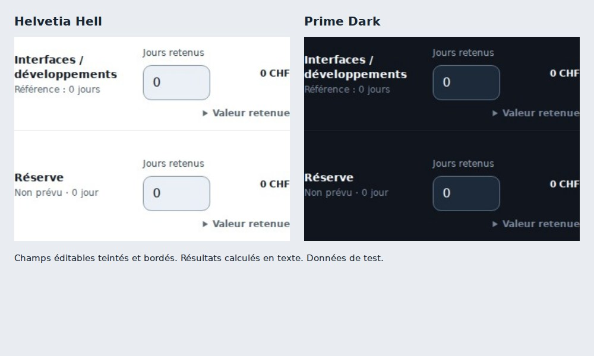

# Check-up de finalisation et des champs — 24 octobre 2026

Base de reprise : production `aec6d0023e7dd79c2b1e5e3b9d71216fad426695`.
Les changements intervenus depuis r6 (partage, compteurs, résumé Natel,
hiérarchie commerciale et design commun) ont été repris avant toute correction.

## Défauts corrigés

- L’alerte SQL dépendait du catalogue non confirmé, même après une saisie valide.
  Elle suit désormais le montant retenu, disparaît après confirmation (zéro
  compris) et revient si l’on efface la valeur. Les cœurs par défaut sont affichés.
- Les appels à compléter changent d’onglet, ouvrent les détails parents, cadrent
  et ciblent le champ précis. La checklist courante nomme les prix SQL, jours de
  module et montants d’hébergement manquants. Les autres points sont repliables.
- Les jours retenus utilisent le zéro explicite des références/presets. Une
  prestation facultative absente affiche zéro et « Non prévu ». Une valeur
  réellement inconnue dans une ligne conservée reste inconnue. Les sorties de
  prix sont mises à jour de la même manière, sans zéro fabriqué pour un prix SQL.
- Le message de sauvegarde ne renvoie plus à « au-dessus ». Les modifications
  affichent leur statut non enregistré ; les totaux suivent les données actuelles.
- Le bouton « Compléter avant partage » agit sur les champs ; « Enregistrer avant
  partage » utilise la sauvegarde existante. La publication reste une action
  explicite ultérieure. Les offres archivées gardent le blocage explicite.
- L’export d’une offre incomplète conduit à la correction avant toute requête de
  fichier. Une offre complète mais modifiée demande la sauvegarde, ciblée.
- Synthèse accédait sans garde aux jours manquants d’un snapshot sans référence,
  alors que le moteur peut omettre cette propriété. Ce plantage est corrigé.
  Une absence de référence ne suffit plus à déclarer un « ancien standard » :
  la comparaison des versions reste le critère de cette alerte.

## Champs : correction de la cascade commune

La surface de champ existante était écrasée dans `skins.css` par une règle
commune à toutes les zones de saisie et aux contrôles ordinaires. Cette règle
est séparée à sa source : les saisies utilisent réellement `--pc-field-bg` et
`--pc-field-border`, les autres contrôles gardent leur surface de contrôle.
Les deux apparences ont des teintes et bordures plus distinctes. Le focus et les
ajustements manuels restent gérés par leurs états existants. Les résultats
calculés restent en texte. Aucun nouveau système CSS propre à un onglet.

## Vérifications et limites

- 157 tests passent ; build de production et `git diff --check` réussissent.
- 24 parcours répétés : 360, 430, 768, 1366, 1920, 2560 px × deux langues × deux
  apparences. SQL saisi/effacé/zéro, jours de module zéro sauvegardés, fermeture
  des alertes, export vers la correction, zéro de référence, zéro facultatif et
  montants correspondants. Aucun débordement global ni erreur JavaScript.
- Les couleurs calculées des champs sont contrôlées dans le navigateur, pour
  détecter une vraie régression de cascade que le seul contrôle du source rate.
- Abacus seul et ProConcept seul, sans innosolv : aucun champ ni alerte SQL.
  Le SQL reste lié à innosolv ; son tarif par cœur inconnu nécessite toujours
  une confirmation, selon les règles privées actuelles. Aucun montant SQL n’a
  été inventé. Le moteur n’a pas été changé.
- Snapshot réellement sans référence : pas de plantage et même convention de
  complétude que le moteur historique. Les règles de jours ne sont pas élargies.
- Partage de recette : sauvegarde, génération du lien fictif, copie, fermeture,
  gestion des liens et fermeture. API en mémoire et fenêtre simulée, sans création
  de lien ni lecture d’offre privée en production. Les tests existants de
  projection client, droits et exports restent au vert.
- [Parcours](qa/chiffrage-20261024-completion/checks.json) et
  [inventaire des boutons](qa/chiffrage-20261024-completion/actions.json).
  L’inventaire statique ne prétend pas être un clic réel sur chaque action
  destructive. Les offres privées, le moteur, les standards, les catalogues,
  l’API et le schéma ne sont pas modifiés.

Les exemples Bex (9’500 habitants, prix et volumes de démonstration) sont
fictifs. Aucun chiffrage existant n’est réécrit automatiquement ; ouvrir une
offre actualise sa présentation et ses alertes, et toute correction des valeurs
reste à enregistrer. Les règles de visibilité et la version des ressources sont
mises à jour ensemble pour éviter les anciens fichiers en cache.
