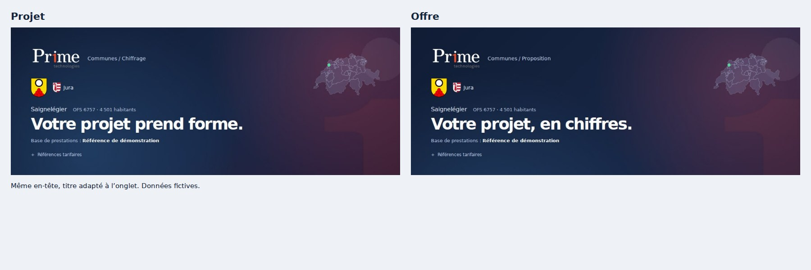
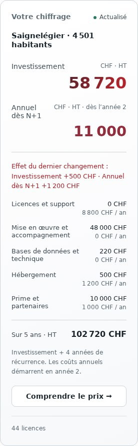

# Cadre commun du chiffrage — r6 · 23 octobre 2026

L’harmonisation reste limitée au Chiffrage. Le logo, les blasons, la carte, les
marges et les styles de titres proviennent d’un unique en-tête, partagé par
Projet, Licences, Prestations, Offre, Comparer et Synthèse (également les taux
internes). Le titre et le libellé de contexte suivent l’onglet. Seule l’Offre
ajoute ses montants à ce bandeau. Les vues du reste du site sont inchangées.

La navigation et l’en-tête sont hors de la grille du contenu : ils gardent leur
largeur lorsque l’Offre et Comparer passent en pleine page. Le résumé reste à
droite sur ordinateur et après le contenu sur Natel, sans remonter avant les
onglets dans Synthèse. Les commandes et le nom de variante sont communs et
restent avant la navigation ; le statut a le même emplacement dans tous les
onglets. Les références tarifaires sont consultables dans le bandeau commun.
Les répétitions de commune, de référence et de champ de titre ont été réduites,
et la numérotation isolée « 02 » a été retirée.

## Deux postes, selon la demande

Le résumé, l’Offre et la Synthèse utilisent désormais la même partition :
licences, prestations, bases de données, hébergement, Prime et partenaires,
LCM. L’hébergement est isolé quelle que soit sa provenance. Les lignes Prime
hors hébergement ne sont plus rangées dans les licences. Les partenaires hors
hébergement restent avec Prime, dans un seul poste. Aucun montant ni total du
moteur n’est modifié et aucun catalogue ou chiffrage enregistré n’est réécrit.

## FR/DE

Les messages générés conservent leur fonction de traduction plutôt qu’un seul
texte figé : changer de langue après une sauvegarde traduit immédiatement le
statut. Les duplications utilisent le suffixe de la langue courante. Les noms
libres déjà enregistrés restent inchangés. Pour les références, les libellés
FR/DE explicites sont prioritaires ; le préfixe généré « Référence » s’affiche
« Referenz » en allemand. Les noms personnalisés ne sont pas traduits
arbitrairement. La mention HT du bandeau devient « exkl. MwSt. » en allemand.

## Validation

- 128 tests passent ; build de production et `git diff --check` réussis.
- Deux tests de présentation vérifient la localisation sans mutation de source
  et la séparation hébergement / Prime et partenaires, sans perte de montants.
- 144 contrôles : six onglets × six largeurs × deux langues × deux apparences.
  Une seule occurrence du bandeau, même largeur et même position de navigation,
  mêmes styles de titre/padding/logo et même ancrage de carte, absence de débordement global et résumé
  placé après le contenu sur Natel. Aucune erreur JavaScript.
- Sauvegarde puis changement FR → DE → FR : statut traduit immédiatement et
  titre saisi conservé. Duplication allemande : suffixe « Kopie ». Le bandeau
  reflète les changements de population sans devoir changer d’onglet.
- Parcours d’édition : jours personnalisés, indicateur manuel, titre, ligne Prime,
  sauvegarde, changement de référence de comparaison, deux et trois variantes.
- [Résultats de structure](qa/chiffrage-20261023-r6/checks.json).

Les données de recette sont fictives et les sauvegardes se font en mémoire dans
le harnais. Aucune offre privée en production n’a été lue ni modifiée pour ces
contrôles. Moteur, règles de configuration, standards, données métier, schéma,
API, authentification et exports sont conservés. La version des ressources est
mise à jour pour charger cette révision du cadre et des traductions.
